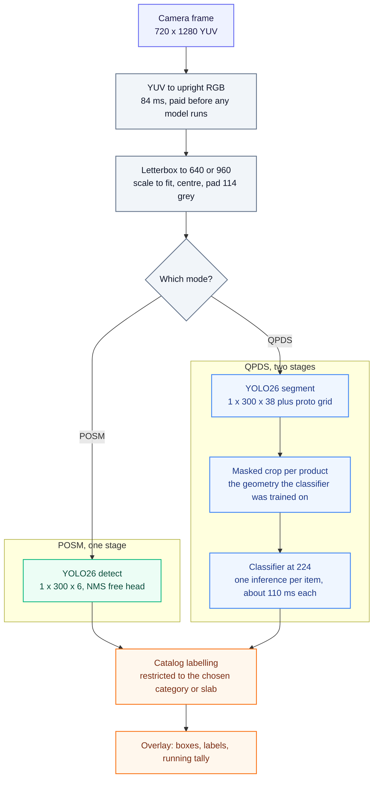

# localVision

**Real time retail shelf analysis on an Android phone, fully offline.**

[](#requirements)
[](#project-layout)
[](#architecture)
[](#privacy)

Point the camera at a shop shelf. localVision detects the products and the
promotional material, names them, counts them and draws the boxes, entirely on
the phone's GPU. It declares no network permission, so a shelf photograph
cannot leave the device.

It runs the same detection models a retail audit backend runs on a server,
with no round trip and no connection.

## Demo

https://github.com/user-attachments/assets/a0d02c05-7698-4777-bf82-a8b0d0e64801

Choosing a QPDS slab, then live two-stage detection with the running tally.

## Usage

Pick **POSM** or **QPDS**, then a category or a slab, then point the camera.

- **POSM** is point of sale material: posters, danglers, stickers. One stage,
  one model, 48 classes.
- **QPDS** is the products on a planogram slab. Two stages: segment the
  products, then classify each against the 59 SKUs the classifier knows.

The choice restricts labelling to the classes that entry expects, which is
faster to read and more accurate, since a classifier choosing among a slab's
own SKUs makes fewer mistakes than one choosing among all 59.

Each entry in the picker carries its state, from the catalog's reconciliation
against the shipped model: plain where every expected class is present, amber
where some are missing, greyed out and not tappable where none are.

### Controls

| | |
|---|---|
| slider | confidence, default 0.30, the server's `posm.confidence` |
| 640 / 960 | inference resolution |
| Filter | restrict to the entry's classes, or show everything the model finds |
| GPU | switch delegate; CPU starts faster but runs about 4x slower per frame |
| Boxes | hide the boxes, keep the tally |
| Hold | freeze the overlay so labels can be read |
| Save | write the frame and its labels to app storage |

Turning **Filter** off is the useful diagnostic: with it on, "not detected"
and "detected as something this category does not expect" look identical.

## Scope

This is a viewer. It does not score compliance and it is not a measurement of
model accuracy. Its labels will differ from the server's by design:

- it runs at 640 or 960, where production runs QPDS segmentation at 1280, a
  setting worth a measured +84.8% on images where 640 finds fewer than 10
  products
- the models are quantized (`w8a32`), which shifts scores and occasionally
  flips a marginal class
- there is no compliance layer: no planogram, order checks, shelftalker,
  exclusivity, SOS or sachet, and no aggregation

A product this app misses is therefore not evidence that production missed it.

### Validation

The shipped `.tflite` files were run through an independently written Python
reference and matched positionally at IoU 0.5, so a class flip on an agreeing
box is visible rather than hidden:

| pipeline | matched | ref only | app only | class flips | mean IoU |
|---|---|---|---|---|---|
| POSM, 640 | 5 | 0 | 0 | 0 | 0.990 to 0.997 |
| QPDS two stage, 640 | 24 | 0 | 0 | 0 | 0.987 |

Nothing invented, nothing lost, no class flipped. Method and reasoning in
`docs/validation.md`.

## Architecture



**Export contract.** The models are YOLO26, exported `format=litert,
quantize=w8a32, nms=False`. That flag ships the NMS-free one2one head, a fixed
`[1, 300, 6]`, so the app never runs NMS. Without it the export silently
produces the raw one2many head, `[1, 52, 8400]` and duplicate heavy. Both are
recorded in `docs/model-contract.md`.

**Quantization.** `w8a32`, int8 weights with float32 activations. Static int8
was measured and rejected: Ultralytics disables the NMS-free head when
activations are quantized, so it would require implementing NMS by hand.

**Crop geometry.** The QPDS classifier was trained on crops built a particular
way, so each mask cell is mapped back through the letterbox to the source
pixels it covers rather than indexed by its fraction of the box.

**Model lifetime.** The model depends on mode and resolution, never on the
category, so the pool holds it across screens and a second category costs
about 1 ms instead of 3.5 s. It is released 30 seconds after nothing wants it,
and immediately when the app stops being visible, because an interpreter on
the GPU delegate holds roughly 760 MB of working buffers against 143 MiB of
model file.

## Performance

Samsung Galaxy S23+, Snapdragon 8 Gen 2, over fixture images rather than the
live camera. Means over 20 runs for POSM and 10 for QPDS.

| Pipeline | imgsz | Delegate | Load | Frame |
|---|---|---|---|---|
| POSM | 640 | GPU | 4560 ms | **368 ms** |
| POSM | 960 | GPU | 5406 ms | 705 ms |
| QPDS | 640 | GPU | 7442 ms | 3086 ms |
| POSM | 640 | CPU | **124 ms** | 1384 ms |
| QPDS | 640 | CPU | 117 ms | 4456 ms |

POSM 640 on GPU runs at about 2.2 frames per second, QPDS at 0.32. The preview
stays smooth at its own rate and the boxes trail it.

The camera appears in about 150 ms; the first boxes take seconds. That is GPU
delegate initialisation: the memory map costs 0 ms and interpreter
construction 3035 ms. Two things reduce the wait in practice. Models are
warmed while the picker is on screen, and QPDS opens its two models
concurrently, 5243 ms down to 4005 ms. The table above loads them
sequentially, as the benchmark does.

QPDS costs about 110 ms per product, because the exported classifier takes a
fixed batch of 1, so a 24 product shelf spends 2.6 s in stage two.

Full table and method in `docs/benchmarks.md`.

## Privacy

The app declares no network permission, so the platform refuses network access
and no code added later can send a shelf photo anywhere. A device test asserts
that the shipped manifest requests `CAMERA` and nothing else:

```kotlin
assertEquals(listOf("android.permission.CAMERA"), platform)
```

Saved frames are written to app-private storage rather than the gallery,
because they are photographs of someone's shop:

```bash
adb shell run-as com.tdi.ubldetect ls files/frames
```

## Requirements

Developed against one device: the Samsung Galaxy S23+ (SM-S916N), Snapdragon 8
Gen 2, Android 17. `minSdk` is 29 and other devices may work, but none have
been tried.

## Building

The model files are not in this repository. They are 29 to 64 MB each and are
produced by the export tooling rather than committed; without them the app
builds and installs but detects nothing. See `tools/README.md`: export runs in
WSL2, since Ultralytics LiteRT export is Linux and macOS only, and the results
belong in `app/src/main/assets/models/`.

Requires Android Studio's bundled JDK 21.

```bash
export JAVA_HOME="/c/Program Files/Android/Android Studio/jbr"
./gradlew :app:installDebug
```

### Tests

```bash
./gradlew :app:testDebugUnitTest          # 148 JVM tests
./gradlew :app:connectedDebugAndroidTest  #  39 on the device
cd tools && python -m pytest tests/ -q    #  51 for the export and catalog tooling
```

`connectedDebugAndroidTest` uninstalls the app when it finishes, so install
after running it rather than before. Anything writing results to app storage,
such as the label dump or the benchmark, must be driven with `adb shell am
instrument` instead, or the output is deleted with the app.

## Project layout

```
tools/          export and catalog generation (Python, WSL2, never shipped)
app/            the app (Kotlin, CameraX, LiteRT)
  imaging/      letterbox, YUV to RGB, input tensor, masked crops
  infer/        interpreter, detect and segment decoders, classifier, model pool
  pipeline/     POSM one stage, QPDS two stage
  catalog/      the generated class catalog
  ui/           picker, camera, overlay, tally, loading, controls
docs/           model contract, validation, benchmarks
```

`docs/model-contract.md` records what the exported models take and return,
measured rather than assumed, including two traps: exporting without
`nms=False` produces a different, duplicate-heavy head, and resampling with a
filter (PIL rather than cv2) changes which class wins.

`docs/validation.md` records what was verified, what was not, and why static
int8 was rejected.
