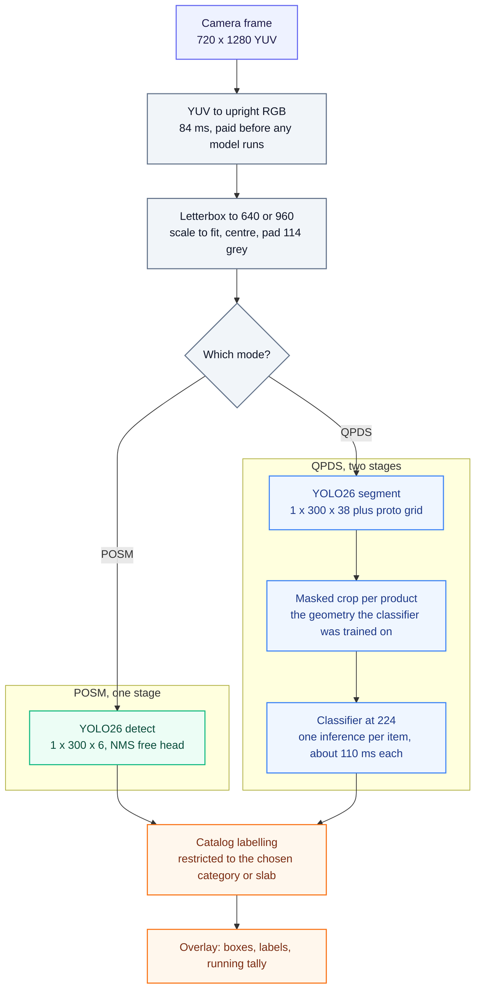

# localVision

**Real time retail shelf analysis on an Android phone, fully offline.**

[](#supported-device)
[](#how-it-is-put-together)
[](#how-it-works)
[](#privacy)

Point the camera at a shop shelf. localVision finds the products and the
promotional material, names them, counts them and draws the boxes, all on the
phone's own GPU. The app declares **no network permission at all**, so a shelf
photograph cannot leave the device even in principle.

It runs the same detection models a retail audit backend runs on a server, and
it runs them in your hand with no round trip and no connection.

## Demo

https://github.com/user-attachments/assets/a0d02c05-7698-4777-bf82-a8b0d0e64801

Eleven seconds: choosing a QPDS slab, then live two-stage detection with the
running tally of what was found and how many.

## What it does

Pick **POSM** or **QPDS**, then a category or a slab, then point the camera.

- **POSM** is point of sale material: posters, danglers, stickers, the things a
  brand puts up around a shop. One stage, one model, 48 classes.
- **QPDS** is the products themselves on a planogram slab. Two stages: segment
  the products, then classify each one against the 59 SKUs the classifier
  knows.

Choosing matters. It restricts labelling to the classes that entry expects,
which is both faster to read and more accurate, since a classifier choosing
among a slab's own SKUs makes fewer mistakes than one choosing among all 59.

The picker shows what each entry can actually do, from the catalog's
reconciliation against the shipped model:

- **plain** means every class it expects is in the model
- **amber** means some are missing, which is normal: SKUs reach the standards
  before a model is trained to detect them
- **greyed out and not tappable** means the model has none of its classes, so
  it could never label anything

### Controls

| | |
|---|---|
| slider | confidence, default 0.30, the server's `posm.confidence` |
| 640 / 960 | inference resolution; lower is faster, higher sees more |
| Filter | restrict to the entry's classes, or show everything the model finds |
| GPU | switch delegate; CPU starts far faster but runs about 4x slower |
| Boxes | hide the boxes and keep the tally, for a clear look at the shelf |
| Hold | freeze the overlay so labels can be read |
| Save | write the frame and its labels to app storage |

**Filter off is the useful diagnostic.** With it on, "not detected" and
"detected as something this category does not expect" look identical. Turning
it off tells them apart.

A floating tally sits over the preview with each label and its count, sorted by
count, overflow folded into a `+N more` row that keeps the total honest.

## This is not an accuracy measurement

Worth saying early, because it is the easiest mistake to make with it.

It is a viewer. It shows you what the models see. It does not score compliance,
and it is not a measurement of how good the models are.

The labels this app draws **will differ from the server's**, by design:

- it runs at **640 or 960**, where production runs QPDS segmentation at
  **1280**, a setting worth a measured +84.8% on images where 640 finds fewer
  than 10 products
- the models are **quantized** (`w8a32`), and quantization shifts scores and
  occasionally flips a marginal class
- there is **no compliance layer at all**: no planogram, no order checks, no
  shelftalker, exclusivity, SOS or sachet, no aggregation

So a product this app misses is not evidence that production missed it, and a
label it gets wrong is not a production defect. Use it to see detections with
your own eyes, not to judge a model.

What *was* verified is that the app implements the pipeline correctly. The same
exported `.tflite` files were run through an independently written Python
reference, and the two sets of detections were matched positionally at IoU 0.5
so that a class flip on an agreeing box shows up rather than hiding:

| pipeline | matched | ref only | app only | class flips | mean IoU |
|---|---|---|---|---|---|
| POSM, 640 | 5 | 0 | 0 | 0 | 0.990 to 0.997 |
| QPDS two stage, 640 | 24 | 0 | 0 | 0 | 0.987 |

Nothing invented, nothing lost, no class flipped. `docs/validation.md` has the
method and the reasoning, including why the reference deliberately takes a
different route to the segmentation mask.

## How it works



Four places where the detail matters:

**The export flag decides the contract.** The models are YOLO26, exported
`format=litert, quantize=w8a32, nms=False`. That last flag ships the NMS-free
one2one head, a fixed `[1, 300, 6]`, so the app never runs NMS. Export without
it and you silently get the raw one2many head instead, `[1, 52, 8400]` and
duplicate heavy. `docs/model-contract.md` records both, measured.

**Quantization is `w8a32`, not static int8.** Int8 weights with float32
activations, so a checkpoint halves rather than quarters. Static int8 was
measured and rejected: Ultralytics force-disables the NMS-free head when
activations are quantized, so adopting it would have meant adopting the raw
head and writing NMS by hand.

**The masked crop geometry is not a free choice.** The QPDS classifier was
trained on crops built a particular way, so the app reproduces it: each mask
cell is mapped back through the letterbox to the source pixels it actually
covers, rather than indexed by its fraction of the box.

**Models are held between screens, briefly.** Which model to run depends on the
mode and the resolution, never on the category, so returning to the picker and
choosing again used to reload a 57 MB interpreter for nothing. They are now
kept, and the second category costs about 1 ms instead of 3.5 s. Briefly,
because an interpreter on the GPU delegate holds working buffers far larger
than its weights: the QPDS pair measured about 760 MB, against 143 MiB of model
file. So they are released 30 seconds after nothing wants them, and at once
when the app stops being visible.

## Speed, measured

Samsung Galaxy S23+, Snapdragon 8 Gen 2, over fixture images rather than the
live camera, means over 20 runs for POSM and 10 for QPDS.

| Pipeline | imgsz | Delegate | Load | Frame |
|---|---|---|---|---|
| POSM | 640 | GPU | 4560 ms | **368 ms** |
| POSM | 960 | GPU | 5406 ms | 705 ms |
| QPDS | 640 | GPU | 7442 ms | 3086 ms |
| POSM | 640 | CPU | **124 ms** | 1384 ms |
| QPDS | 640 | CPU | 117 ms | 4456 ms |

POSM 640 on GPU is about **2.2 frames per second**, QPDS about **0.32**. The
preview stays smooth at its own rate and the boxes trail it.

Two numbers worth knowing before you use it:

**The camera appears in 125 ms; the first boxes take about 4.5 s.** That is GPU
delegate initialisation, not the app hanging, and the status pill says so while
it happens. The memory map itself costs 0 ms; interpreter construction costs
3035 ms. CPU loads in 124 ms but each frame then costs nearly 4x more. Models
are warmed while the picker is on screen, so most of that wait is already over
by the time you tap.

**QPDS costs about 110 ms per product.** Stage two runs one inference per
detected item because the exported classifier takes a fixed batch of 1, so a 24
product shelf spends 2.6 s classifying.

Full table and method in `docs/benchmarks.md`.

## Privacy

The app **declares no network permission at all**, so the platform refuses
network access and no code added later can send a shelf photo anywhere. That is
structural rather than a promise, and a device test asserts that the shipped
manifest requests `CAMERA` and nothing else:

```kotlin
assertEquals(listOf("android.permission.CAMERA"), platform)
```

Saved frames land in app-private storage, not the gallery, because they are
photographs of someone's shop:

```bash
adb shell run-as com.tdi.ubldetect ls files/frames
```

## Supported device

One: the Samsung Galaxy S23+ (SM-S916N), Snapdragon 8 Gen 2, Android 17.
`minSdk` is 29 and other devices may work, but nothing else has been tried.

## Building

**The model files are not in this repository.** They are 57 MB each, produced
by the export tooling rather than committed. Without them the app builds and
installs but finds nothing. See `tools/README.md`: export runs in WSL2, since
Ultralytics LiteRT export is Linux and macOS only, and the results belong in
`app/src/main/assets/models/`.

Needs Android Studio's bundled JDK 21; the `java` on `PATH` is likely too old
for AGP.

```bash
export JAVA_HOME="/c/Program Files/Android/Android Studio/jbr"
./gradlew :app:installDebug
```

### Tests

```bash
./gradlew :app:testDebugUnitTest          # 142 JVM tests
./gradlew :app:connectedDebugAndroidTest  #  35 on the device
cd tools && python -m pytest tests/ -q    #  51 for the export and catalog tooling
```

**`connectedDebugAndroidTest` uninstalls the app when it finishes.** Install
after running it, not before, or the phone is left with no app. Anything that
writes results to app storage (the label dump, the benchmark) must be driven
with `adb shell am instrument` instead, or the output is deleted with the app.

## How it is put together

```
tools/          export and catalog generation (Python, WSL2, never shipped)
app/            the app (Kotlin, CameraX, LiteRT)
  imaging/      letterbox, YUV to RGB, input tensor, masked crops
  infer/        interpreter, detect and segment decoders, classifier, model pool
  pipeline/     POSM one stage, QPDS two stage
  catalog/      the generated class catalog
  ui/           picker, camera, overlay, tally, controls
docs/           model contract, validation, benchmarks
```

Two documents are worth reading before changing anything:

**`docs/model-contract.md`** records what the exported models actually take and
return, measured rather than assumed. It also records the two traps: exporting
without `nms=False` silently produces a different, duplicate-heavy head, and
resampling with a filter (PIL rather than cv2) changes which class wins.

**`docs/validation.md`** records what was verified, what was not, and why static
int8 was rejected.
